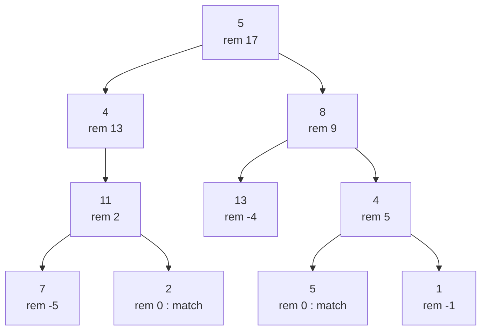

# Path Sum II

Given the root of a binary tree and an integer `targetSum`, return all root-to-leaf paths where the sum of the node values equals `targetSum`. Each path is a list of node values, not node references.

## Algorithm Strategy (DFS with Backtracking)

1. Walk the tree depth first, keeping the current path in one shared list and the remaining sum.
2. On entering a node add its value to the path and subtract it from the remaining sum.
3. If the node is a leaf and the remaining sum is now 0, copy the path into the result (the copy matters because the shared list keeps changing).
4. Visit the children, then remove the node from the path before returning (backtrack) so that the sibling subtree starts from the correct path.

## Example walkthrough

- For `[5, 4, 8, 11, null, 13, 4, 7, 2, null, null, 5, 1]` with `targetSum = 22`: the path `5, 4, 11, 2` sums to 22 and so does `5, 8, 4, 5`.
- Result: `[[5, 4, 11, 2], [5, 8, 4, 5]]`.

## Complexity Analysis

- **Time Complexity:** `O(n^2)` — Visiting is `O(n)`, and copying a path of length up to `h` for each leaf can add up to `O(n * h)`.
- **Space Complexity:** `O(h)` — The path and the recursion stack, not counting the output.

## Approaches

The same problem can be solved in several ways. The approach marked (Optimized) is the one to use in practice.

### Approach 1: Collect All Paths, Then Filter

Build every root-to-leaf path first (copying the path at each leaf), then keep the ones whose sum equals the target.

```java
public static List<List<Integer>> pathSumFilter(TreeNode root, int targetSum) {
    List<List<Integer>> all = new ArrayList<>();
    collect(root, new ArrayList<>(), all);
    List<List<Integer>> result = new ArrayList<>();
    for (List<Integer> path : all) {
        int sum = 0;
        for (int v : path) sum += v;
        if (sum == targetSum) result.add(path);
    }
    return result;
}

private static void collect(TreeNode node, List<Integer> prefix, List<List<Integer>> all) {
    if (node == null) return;
    List<Integer> path = new ArrayList<>(prefix);
    path.add(node.val);
    if (node.left == null && node.right == null) all.add(path);
    collect(node.left, path, all);
    collect(node.right, path, all);
}
```

- **Time Complexity:** O(n^2)
- **Space Complexity:** O(n * h) for all paths

### Approach 2: DFS with Backtracking (Optimized)

Share one path list across the recursion and copy it only when a matching leaf is found. This is the version implemented in the repository.

```java
public static List<List<Integer>> pathSum(TreeNode root, int targetSum) {
    List<List<Integer>> result = new ArrayList<>();
    dfs(root, targetSum, new ArrayList<>(), result);
    return result;
}

private static void dfs(TreeNode node, int remaining, List<Integer> path, List<List<Integer>> result) {
    if (node == null) {
        return;
    }
    path.add(node.val);
    remaining -= node.val;
    if (node.left == null && node.right == null && remaining == 0) {
        result.add(new ArrayList<>(path));
    }
    dfs(node.left, remaining, path, result);
    dfs(node.right, remaining, path, result);
    path.remove(path.size() - 1);
}
```

- **Time Complexity:** O(n^2) worst case
- **Space Complexity:** O(h) besides the output

### Comparison

| # | Approach | Time | Space |
|---|----------|------|-------|
| 1 | Collect All Paths, Then Filter | O(n^2) | O(n * h) for all paths |
| 2 | DFS with Backtracking (Optimized) | O(n^2) worst case | O(h) besides the output |

## Source Code

### PathSumII.java

```java
import java.util.ArrayList;
import java.util.List;

public class PathSumII {

    public static void main(String[] args) {
        Integer[][] inputs = {
                {5, 4, 8, 11, null, 13, 4, 7, 2, null, null, 5, 1},
                {1, 2, 3},
                {1, 2}
        };
        int[] targets = {22, 5, 0};
        for (int i = 0; i < inputs.length; i++) {
            TreeNode root = TreeNode.of(inputs[i]);
            System.out.println("Input  : root = " + TreeNode.toString(root) + ", targetSum = " + targets[i]);
            System.out.println("Output : " + pathSum(root, targets[i]));
            System.out.println();
        }
    }

    public static List<List<Integer>> pathSum(TreeNode root, int targetSum) {
        List<List<Integer>> result = new ArrayList<>();
        dfs(root, targetSum, new ArrayList<>(), result);
        return result;
    }

    private static void dfs(TreeNode node, int remaining, List<Integer> path, List<List<Integer>> result) {
        if (node == null) {
            return;
        }
        path.add(node.val);
        remaining -= node.val;
        if (node.left == null && node.right == null && remaining == 0) {
            result.add(new ArrayList<>(path));
        }
        dfs(node.left, remaining, path, result);
        dfs(node.right, remaining, path, result);
        path.remove(path.size() - 1);
    }
}
```

## Solution

The optimized solution is Approach 2 above, which is also the version implemented in this repository.

The idea: walk the tree depth first with one shared `path` list and a `remaining` sum. Entering a node adds it to the path and subtracts its value; at a leaf with `remaining == 0` a copy of the path is stored; leaving the node removes it again (backtracking), so the sibling subtree starts from the right path. The path is copied only for real answers.

**Input:** `root = [5, 4, 8, 11, null, 13, 4, 7, 2, null, null, 5, 1]`, `targetSum = 22`.

| Step | Node | `remaining` after subtracting | `path` after adding | Leaf? | Action |
|------|------|-------------------------------|---------------------|-------|--------|
| 1 | 5 | 17 | `[5]` | no | go left |
| 2 | 4 | 13 | `[5, 4]` | no | go left |
| 3 | 11 | 2 | `[5, 4, 11]` | no | go left |
| 4 | 7 | -5 | `[5, 4, 11, 7]` | yes | not 0, backtrack to `[5, 4, 11]` |
| 5 | 2 | 0 | `[5, 4, 11, 2]` | yes | **store copy**, backtrack |
| 6 | 8 | 9 | `[5, 8]` | no | (4 and 11 are finished, their right children are null) |
| 7 | 13 | -4 | `[5, 8, 13]` | yes | not 0, backtrack |
| 8 | 4 | 5 | `[5, 8, 4]` | no | go left |
| 9 | 5 | 0 | `[5, 8, 4, 5]` | yes | **store copy**, backtrack |
| 10 | 1 | -1 | `[5, 8, 4, 1]` | yes | not 0, backtrack |



**Edge cases:** an empty tree returns an empty list. Only leaves count: for `[1, 2]` with target `0` nothing matches (the path `1, 2` sums to 3, and node `1` is not a leaf), and for `[1, 2, 3]` with target `5` no leaf path sums to 5, so both return `[]`.

**Result:** `[[5, 4, 11, 2], [5, 8, 4, 5]]`, the same as the class output.
