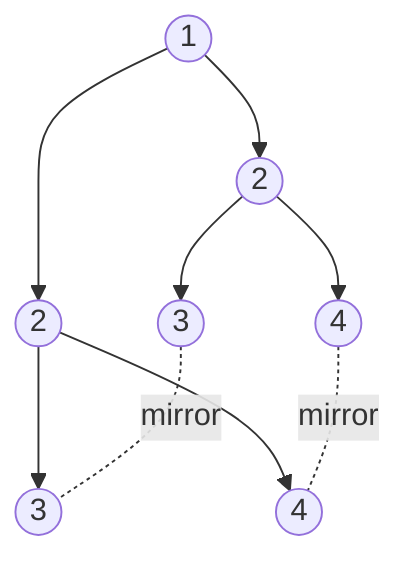

# Symmetric Tree

Given the root of a binary tree, check whether it is a mirror of itself, that is, symmetric around its center.

## Algorithm Strategy (Recursive Mirror Comparison)

1. A tree is symmetric when its left and right subtrees are mirror images of each other.
2. Define `isMirror(a, b)`: two empty subtrees are mirrors; if only one is empty they are not.
3. Otherwise the values must be equal, and the outer children must mirror each other (`a.left` with `b.right`) and the inner children must mirror each other (`a.right` with `b.left`).
4. Call `isMirror(root.left, root.right)` for the answer. Every node is visited once.

## Example walkthrough

- For `[1, 2, 2, 3, 4, 4, 3]`: the two 2s match, then 3 pairs with 3 and 4 pairs with 4, so the tree is symmetric.
- For `[1, 2, 2, null, 3, null, 3]` the 3s sit on the same side of both subtrees, so it is not.

## Complexity Analysis

- **Time Complexity:** `O(n)` — Each node is compared once.
- **Space Complexity:** `O(h)` — Recursion depth, equal to the tree height.

## Approaches

The same problem can be solved in several ways. The approach marked (Optimized) is the one to use in practice.

### Approach 1: Iterative with a Queue of Pairs

Put the two children of the root in a queue as a pair; repeatedly take two nodes off the queue, compare them and enqueue their children in mirrored order.

```java
public static boolean isSymmetricIterative(TreeNode root) {
    if (root == null) return true;
    Queue<TreeNode> queue = new LinkedList<>();
    queue.add(root.left);
    queue.add(root.right);
    while (!queue.isEmpty()) {
        TreeNode a = queue.remove();
        TreeNode b = queue.remove();
        if (a == null && b == null) continue;
        if (a == null || b == null || a.val != b.val) return false;
        queue.add(a.left);
        queue.add(b.right);
        queue.add(a.right);
        queue.add(b.left);
    }
    return true;
}
```

- **Time Complexity:** O(n)
- **Space Complexity:** O(w) for the queue

### Approach 2: Build the Mirror and Compare

Create a mirrored copy of the tree and compare it with the original node by node.

```java
public static boolean isSymmetricMirrorCopy(TreeNode root) {
    return same(root, mirror(root));
}

private static TreeNode mirror(TreeNode node) {
    if (node == null) return null;
    TreeNode m = new TreeNode(node.val);
    m.left = mirror(node.right);
    m.right = mirror(node.left);
    return m;
}

private static boolean same(TreeNode a, TreeNode b) {
    if (a == null || b == null) return a == b;
    return a.val == b.val && same(a.left, b.left) && same(a.right, b.right);
}
```

- **Time Complexity:** O(n)
- **Space Complexity:** O(n) for the copy

### Approach 3: Recursive Mirror Check (Optimized)

Compare the outer pair and the inner pair of grandchildren recursively without building anything. This is the version implemented in the repository.

```java
public static boolean isSymmetric(TreeNode root) {
    return root == null || isMirror(root.left, root.right);
}

private static boolean isMirror(TreeNode a, TreeNode b) {
    if (a == null || b == null) {
        return a == b;
    }
    return a.val == b.val && isMirror(a.left, b.right) && isMirror(a.right, b.left);
}
```

- **Time Complexity:** O(n)
- **Space Complexity:** O(h)

### Comparison

| # | Approach | Time | Space |
|---|----------|------|-------|
| 1 | Iterative with a Queue of Pairs | O(n) | O(w) for the queue |
| 2 | Build the Mirror and Compare | O(n) | O(n) for the copy |
| 3 | Recursive Mirror Check (Optimized) | O(n) | O(h) |

## Source Code

### SymmetricTree.java

```java
public class SymmetricTree {

    public static void main(String[] args) {
        Integer[][] inputs = {
                {1, 2, 2, 3, 4, 4, 3},
                {1, 2, 2, null, 3, null, 3},
                {1},
                {1, 2, 3}
        };
        for (Integer[] values : inputs) {
            TreeNode root = TreeNode.of(values);
            System.out.println("Input  : root = " + TreeNode.toString(root));
            System.out.println("Output : " + isSymmetric(root));
            System.out.println();
        }
    }

    public static boolean isSymmetric(TreeNode root) {
        return root == null || isMirror(root.left, root.right);
    }

    private static boolean isMirror(TreeNode a, TreeNode b) {
        if (a == null || b == null) {
            return a == b;
        }
        return a.val == b.val && isMirror(a.left, b.right) && isMirror(a.right, b.left);
    }
}
```

## Solution

The optimized solution is Approach 3 above, which is also the version implemented in this repository.

The idea: a tree is symmetric when its left subtree is the mirror image of its right subtree. Two subtrees `a` and `b` are mirrors if their roots have the same value, `a`'s left mirrors `b`'s right, and `a`'s right mirrors `b`'s left. So the code compares two nodes at a time, crossing over at each level, and the whole check is a single recursion with no copy of the tree.

**Input:** `[1, 2, 2, 3, 4, 4, 3]`.



| Step | Call `isMirror(a, b)` | Values | Result |
|------|-----------------------|--------|--------|
| 1 | `(root.left, root.right)` | `2` and `2` | equal, so check the crossed children |
| 2 | `(a.left, b.right)` | `3` and `3` | equal; its children pairs are `(null, null)` twice, both `true` |
| 3 | `(a.right, b.left)` | `4` and `4` | equal; children pairs `(null, null)` twice, both `true` |
| 4 | back at step 1 | | `true && true && true` |

The class returns `true`.

**Asymmetric input.** For `[1, 2, 2, null, 3, null, 3]` the pair at step 1 is `(2, 2)` and the crossed pair is `(a.left, b.right) = (null, 3)`. One side is null, so the method returns `a == b`, which is `false`, and the other crossed pair is never examined. For `[1, 2, 3]` the first pair is `(2, 3)`: different values, `false`.

**Edge cases.** An empty tree (`root == null`) and a single node (both children null, so `isMirror(null, null)` is `true`) are symmetric. The null test `a == null || b == null` returns `a == b`, which is `true` only when both are null. Recursion depth is the tree height, so extra space is `O(h)`.

**Result:** `true`, `false`, `true`, `false` for the four inputs in `main`, matching the class output.
