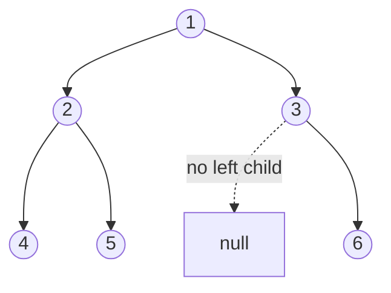

# Binary Tree Traversals (Inorder, Preorder, Postorder)

Print the nodes of a binary tree in the three depth-first orders: preorder (node, left, right), inorder (left, node, right) and postorder (left, right, node). Show both the recursive version and an iterative inorder traversal that uses an explicit stack.

## Algorithm Strategy (Recursion and an Explicit Stack)

1. Recursive traversals follow the definition directly: visit the node before (preorder), between (inorder) or after (postorder) the recursive calls for the left and right children.
2. For a binary search tree the inorder traversal returns the values in sorted order.
3. Iterative inorder: keep a stack. Push the current node and move to its left child until there is none, then pop a node, visit it and continue with its right child.
4. Repeat until the current node is `null` and the stack is empty.

## Example walkthrough

- For the tree `[1, 2, 3, 4, 5, null, 6]`: preorder is `1 2 4 5 3 6`, inorder is `4 2 5 1 3 6` and postorder is `4 5 2 6 3 1`.
- The iterative inorder gives the same `4 2 5 1 3 6` without recursion.

## Complexity Analysis

- **Time Complexity:** `O(n)` — Every node is visited once.
- **Space Complexity:** `O(h)` — The recursion stack or the explicit stack holds at most the height `h` of the tree.

## Approaches

The same problem can be solved in several ways. The approach marked (Optimized) is the one to use in practice.

### Approach 1: Recursive Traversals (Optimized)

Visit the node before, between or after the recursive calls on its children. This is the version implemented in the repository.

```java
public static void preorder(TreeNode node, List<Integer> out) {
    if (node == null) return;
    out.add(node.val);
    preorder(node.left, out);
    preorder(node.right, out);
}

public static void inorder(TreeNode node, List<Integer> out) {
    if (node == null) return;
    inorder(node.left, out);
    out.add(node.val);
    inorder(node.right, out);
}

public static void postorder(TreeNode node, List<Integer> out) {
    if (node == null) return;
    postorder(node.left, out);
    postorder(node.right, out);
    out.add(node.val);
}
```

- **Time Complexity:** O(n)
- **Space Complexity:** O(h)

### Approach 2: Iterative with an Explicit Stack (Optimized)

Replace the call stack by a `Deque`: inorder pushes the left spine, preorder pushes right then left, postorder reverses a modified preorder.

```java
public static List<Integer> inorderStack(TreeNode root) {
    List<Integer> out = new ArrayList<>();
    Deque<TreeNode> stack = new ArrayDeque<>();
    TreeNode current = root;
    while (current != null || !stack.isEmpty()) {
        while (current != null) { stack.push(current); current = current.left; }
        current = stack.pop();
        out.add(current.val);
        current = current.right;
    }
    return out;
}

public static List<Integer> preorderStack(TreeNode root) {
    List<Integer> out = new ArrayList<>();
    if (root == null) return out;
    Deque<TreeNode> stack = new ArrayDeque<>();
    stack.push(root);
    while (!stack.isEmpty()) {
        TreeNode node = stack.pop();
        out.add(node.val);
        if (node.right != null) stack.push(node.right);
        if (node.left != null) stack.push(node.left);
    }
    return out;
}

public static List<Integer> postorderStack(TreeNode root) {
    LinkedList<Integer> out = new LinkedList<>();
    if (root == null) return out;
    Deque<TreeNode> stack = new ArrayDeque<>();
    stack.push(root);
    while (!stack.isEmpty()) {
        TreeNode node = stack.pop();
        out.addFirst(node.val);                 // node, right, left read backwards is left, right, node
        if (node.left != null) stack.push(node.left);
        if (node.right != null) stack.push(node.right);
    }
    return out;
}
```

- **Time Complexity:** O(n)
- **Space Complexity:** O(h)

### Approach 3: Morris Inorder Traversal

Temporarily link each node's inorder predecessor back to the node (a thread), so no stack is needed. The tree is restored afterwards.

```java
public static List<Integer> inorderMorris(TreeNode root) {
    List<Integer> out = new ArrayList<>();
    TreeNode current = root;
    while (current != null) {
        if (current.left == null) {
            out.add(current.val);
            current = current.right;
        } else {
            TreeNode predecessor = current.left;
            while (predecessor.right != null && predecessor.right != current) predecessor = predecessor.right;
            if (predecessor.right == null) {
                predecessor.right = current;        // create the thread
                current = current.left;
            } else {
                predecessor.right = null;           // remove the thread
                out.add(current.val);
                current = current.right;
            }
        }
    }
    return out;
}
```

- **Time Complexity:** O(n)
- **Space Complexity:** O(1)

### Comparison

| # | Approach | Time | Space |
|---|----------|------|-------|
| 1 | Recursive Traversals | O(n) | O(h) |
| 2 | Iterative with an Explicit Stack | O(n) | O(h) |
| 3 | Morris Inorder Traversal | O(n) | O(1) |

## Source Code

Uses the shared helper [`TreeNode`](../../src/main/java/com/ranga/tree/TreeNode.java) (a small `TreeNode` with `of(...)` and `toString(...)` helpers for building and printing test data).

### TreeTraversals.java

```java
import java.util.ArrayDeque;
import java.util.ArrayList;
import java.util.Deque;
import java.util.List;

public class TreeTraversals {

    public static void main(String[] args) {
        Integer[][] inputs = {{1, 2, 3, 4, 5, null, 6}, {1, null, 2, 3}, {5}, {}};
        for (Integer[] values : inputs) {
            TreeNode root = TreeNode.of(values);
            System.out.println("Input  : root = " + TreeNode.toString(root));
            System.out.println("Output : preorder  = " + preorder(root));
            System.out.println("         inorder   = " + inorder(root));
            System.out.println("         postorder = " + postorder(root));
            System.out.println("         iterative inorder = " + inorderIterative(root));
            System.out.println();
        }
    }

    public static List<Integer> preorder(TreeNode root) {
        List<Integer> result = new ArrayList<>();
        preorder(root, result);
        return result;
    }

    public static List<Integer> inorder(TreeNode root) {
        List<Integer> result = new ArrayList<>();
        inorder(root, result);
        return result;
    }

    public static List<Integer> postorder(TreeNode root) {
        List<Integer> result = new ArrayList<>();
        postorder(root, result);
        return result;
    }

    public static List<Integer> inorderIterative(TreeNode root) {
        List<Integer> result = new ArrayList<>();
        Deque<TreeNode> stack = new ArrayDeque<>();
        TreeNode current = root;
        while (current != null || !stack.isEmpty()) {
            while (current != null) {
                stack.push(current);
                current = current.left;
            }
            current = stack.pop();
            result.add(current.val);
            current = current.right;
        }
        return result;
    }

    private static void preorder(TreeNode node, List<Integer> result) {
        if (node == null) {
            return;
        }
        result.add(node.val);
        preorder(node.left, result);
        preorder(node.right, result);
    }

    private static void inorder(TreeNode node, List<Integer> result) {
        if (node == null) {
            return;
        }
        inorder(node.left, result);
        result.add(node.val);
        inorder(node.right, result);
    }

    private static void postorder(TreeNode node, List<Integer> result) {
        if (node == null) {
            return;
        }
        postorder(node.left, result);
        postorder(node.right, result);
        result.add(node.val);
    }
}
```

## Solution

The optimized solution is Approach 1 (recursive preorder, inorder and postorder) together with Approach 2 (the iterative inorder with an explicit stack), which are the versions implemented in this repository. Approach 3 (Morris traversal) is the `O(1)`-space variant and is not implemented in the class.

The idea: the three depth-first orders differ only in *when* a node is written down relative to its two subtrees. Preorder writes the node before both subtrees, inorder between them, postorder after both. The recursive methods express that directly; the iterative inorder uses an explicit stack instead of the call stack.

**Input:** the tree `[1, 2, 3, 4, 5, null, 6]`.



**Recursive orders: when each node is written down.**

| Node | Preorder position (before subtrees) | Inorder position (between subtrees) | Postorder position (after subtrees) |
|------|-------------------------------------|-------------------------------------|-------------------------------------|
| 1 | 1 | 4 | 6 |
| 2 | 2 | 2 | 3 |
| 4 | 3 | 1 | 1 |
| 5 | 4 | 3 | 2 |
| 3 | 5 | 5 | 5 |
| 6 | 6 | 6 | 4 |

Reading each column in position order gives `preorder = [1, 2, 4, 5, 3, 6]`, `inorder = [4, 2, 5, 1, 3, 6]` and `postorder = [4, 5, 2, 6, 3, 1]`. A `null` child returns immediately, which is the base case that stops the recursion.

**Iterative inorder with a stack.** `current` walks left, pushing every node it passes; when it cannot go further left it pops a node, writes it down and moves to its right child. The stack is written from bottom to top.

| Step | `current` | Action | Stack | `result` |
|------|-----------|--------|-------|----------|
| 1 | `1` | go left, pushing `1`, `2`, `4`; `4` has no left child | `1 2 4` | `[ ]` |
| 2 | `null` | pop `4`, write it, move to its right child (`null`) | `1 2` | `[4]` |
| 3 | `null` | pop `2`, write it, move to its right child `5` | `1` | `[4, 2]` |
| 4 | `5` | push `5`; `5` has no left child | `1 5` | `[4, 2]` |
| 5 | `null` | pop `5`, write it, right child is `null` | `1` | `[4, 2, 5]` |
| 6 | `null` | pop `1`, write it, move to its right child `3` | (empty) | `[4, 2, 5, 1]` |
| 7 | `3` | push `3`; no left child | `3` | `[4, 2, 5, 1]` |
| 8 | `null` | pop `3`, write it, move to its right child `6` | (empty) | `[4, 2, 5, 1, 3]` |
| 9 | `6` | push `6`; no left child | `6` | `[4, 2, 5, 1, 3]` |
| 10 | `null` | pop `6`, write it, right child is `null` | (empty) | `[4, 2, 5, 1, 3, 6]` |

`current` is `null` and the stack is empty, so the loop ends. The result equals the recursive inorder `[4, 2, 5, 1, 3, 6]`.

**Edge cases.** An empty tree (`root == null`) returns an empty list from all four methods; a single node `5` gives `[5]` in every order. The recursion is as deep as the tree is tall, and so is the explicit stack, which is why both use `O(h)` extra space.
