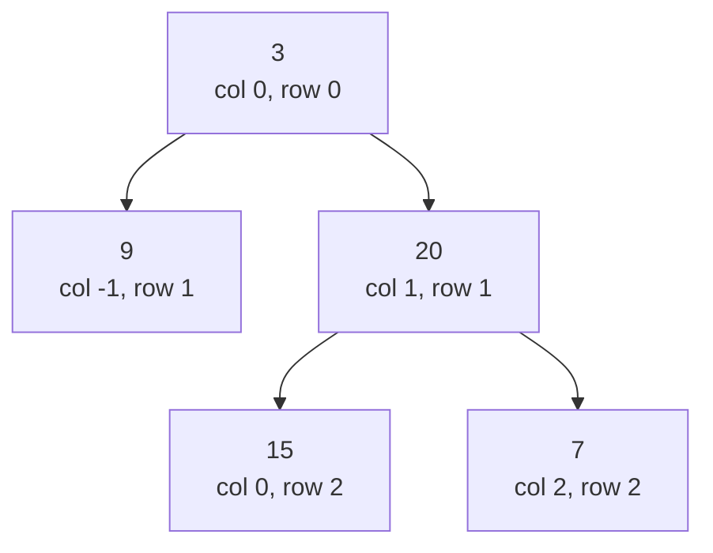

# Vertical Order Traversal of a Binary Tree

Place the root at `(row 0, column 0)`; a node at `(row, col)` has its left child at `(row + 1, col - 1)` and its right child at `(row + 1, col + 1)`. Return the vertical order traversal: the values grouped by column from left to right, and inside a column ordered by row from top to bottom, with nodes that share the same row and column sorted by value.

## Algorithm Strategy (Collect (Column, Row, Value), Sort, Group)

1. Traverse the tree with DFS (any order works) and record a triple `(column, row, value)` for every node, passing the row and column down.
2. Sort the triples by column first, then by row, then by value. The value tie-break is what the problem requires for nodes at the same position.
3. Walk through the sorted triples and start a new group whenever the column changes.
4. Each group, in order, is one entry of the answer.

## Example walkthrough

- For `[3, 9, 20, null, null, 15, 7]`: the triples are `(0, 0, 3), (-1, 1, 9), (1, 1, 20), (0, 2, 15), (2, 2, 7)`.
- Sorted and grouped by column: `[[9], [3, 15], [20], [7]]`.

## Complexity Analysis

- **Time Complexity:** `O(n log n)` — Sorting `n` triples.
- **Space Complexity:** `O(n)` — The triples.

## Approaches

The same problem can be solved in several ways. The approach marked (Optimized) is the one to use in practice.

### Approach 1: BFS with Nested Sorted Maps

Traverse level by level and store values in `TreeMap<column, TreeMap<row, PriorityQueue<value>>>`, so the ordering is maintained while inserting.

```java
public static List<List<Integer>> verticalTraversalMaps(TreeNode root) {
    TreeMap<Integer, TreeMap<Integer, PriorityQueue<Integer>>> map = new TreeMap<>();
    Queue<Object[]> queue = new LinkedList<>();
    if (root != null) queue.add(new Object[]{root, 0, 0});
    while (!queue.isEmpty()) {
        Object[] item = queue.remove();
        TreeNode node = (TreeNode) item[0];
        int row = (Integer) item[1], column = (Integer) item[2];
        map.computeIfAbsent(column, k -> new TreeMap<>())
           .computeIfAbsent(row, k -> new PriorityQueue<>()).add(node.val);
        if (node.left != null) queue.add(new Object[]{node.left, row + 1, column - 1});
        if (node.right != null) queue.add(new Object[]{node.right, row + 1, column + 1});
    }
    List<List<Integer>> result = new ArrayList<>();
    for (TreeMap<Integer, PriorityQueue<Integer>> rows : map.values()) {
        List<Integer> group = new ArrayList<>();
        for (PriorityQueue<Integer> pq : rows.values()) {
            while (!pq.isEmpty()) group.add(pq.poll());
        }
        result.add(group);
    }
    return result;
}
```

- **Time Complexity:** O(n log n)
- **Space Complexity:** O(n)

### Approach 2: Collect, Sort and Group (Optimized)

Record `(column, row, value)` for each node, sort the triples once and cut the sorted list into groups by column. This is the version implemented in the repository.

```java
public static List<List<Integer>> verticalTraversal(TreeNode root) {
    List<int[]> nodes = new ArrayList<>();
    collect(root, 0, 0, nodes);
    nodes.sort((a, b) -> {
        if (a[0] != b[0]) {
            return Integer.compare(a[0], b[0]);
        }
        if (a[1] != b[1]) {
            return Integer.compare(a[1], b[1]);
        }
        return Integer.compare(a[2], b[2]);
    });
    List<List<Integer>> result = new ArrayList<>();
    int lastColumn = Integer.MIN_VALUE;
    for (int[] node : nodes) {
        if (node[0] != lastColumn) {
            result.add(new ArrayList<>());
            lastColumn = node[0];
        }
        result.get(result.size() - 1).add(node[2]);
    }
    return result;
}

private static void collect(TreeNode node, int row, int column, List<int[]> nodes) {
    if (node == null) {
        return;
    }
    nodes.add(new int[]{column, row, node.val});
    collect(node.left, row + 1, column - 1, nodes);
    collect(node.right, row + 1, column + 1, nodes);
}
```

- **Time Complexity:** O(n log n)
- **Space Complexity:** O(n)

### Comparison

| # | Approach | Time | Space |
|---|----------|------|-------|
| 1 | BFS with Nested Sorted Maps | O(n log n) | O(n) |
| 2 | Collect, Sort and Group (Optimized) | O(n log n) | O(n) |

### Optimized Solution

The optimized solution is Approach 2 above, which is also the version implemented in this repository.

#### Optimized solution explained

The idea: give every node a coordinate: `row` is its depth and `column` is its horizontal position (the root is column 0, a left child is one column to the left, a right child one column to the right). One depth-first walk records `{column, row, value}` for every node, the list is sorted by column, then row, then value, and a new output list starts whenever the column changes. Sorting by value as the last key is what orders two nodes sharing the same row and column.

**Input:** the tree `[3, 9, 20, null, null, 15, 7]`.



**Collect** (preorder, so the list is in the order `3, 9, 20, 15, 7`):

| Visit | Node | `row` | `column` | Record `{column, row, value}` |
|-------|------|-------|----------|-------------------------------|
| 1 | `3` | 0 | 0 | `{0, 0, 3}` |
| 2 | `9` | 1 | -1 | `{-1, 1, 9}` |
| 3 | `20` | 1 | 1 | `{1, 1, 20}` |
| 4 | `15` | 2 | 0 | `{0, 2, 15}` |
| 5 | `7` | 2 | 2 | `{2, 2, 7}` |

**Sort and group** (by column, then row, then value):

| Sorted entry | `lastColumn` before | New list started? | `result` after |
|--------------|---------------------|-------------------|----------------|
| `{-1, 1, 9}` | min value | yes | `[[9]]` |
| `{0, 0, 3}` | -1 | yes | `[[9], [3]]` |
| `{0, 2, 15}` | 0 | no | `[[9], [3, 15]]` |
| `{1, 1, 20}` | 0 | yes | `[[9], [3, 15], [20]]` |
| `{2, 2, 7}` | 1 | yes | `[[9], [3, 15], [20], [7]]` |

The result is `[[9], [3, 15], [20], [7]]`.

**Edge cases.** An empty tree collects nothing, so the result is an empty list. A single node gives `[[1]]`. Two nodes in the same column and row, as for `5` and `6` in `[1, 2, 3, 4, 6, 5, 7]` (both at column 0, row 2), are ordered by value, giving `[1, 5, 6]` however the tree is arranged. Time is `O(n log n)` for the sort, space `O(n)`.

**Result:** `[[9], [3, 15], [20], [7]]`, matching the class output (the other inputs print `[[4], [2], [1, 5, 6], [3], [7]]` twice and `[[1]]`).

## Source Code

### VerticalOrderTraversal.java

```java
import java.util.ArrayList;
import java.util.Arrays;
import java.util.List;

public class VerticalOrderTraversal {

    public static void main(String[] args) {
        Integer[][] inputs = {
                {3, 9, 20, null, null, 15, 7},
                {1, 2, 3, 4, 5, 6, 7},
                {1, 2, 3, 4, 6, 5, 7},
                {1}
        };
        for (Integer[] values : inputs) {
            TreeNode root = TreeNode.of(values);
            System.out.println("Input  : root = " + TreeNode.toString(root));
            System.out.println("Output : " + verticalTraversal(root));
            System.out.println();
        }
    }

    public static List<List<Integer>> verticalTraversal(TreeNode root) {
        List<int[]> nodes = new ArrayList<>();
        collect(root, 0, 0, nodes);
        nodes.sort((a, b) -> {
            if (a[0] != b[0]) {
                return Integer.compare(a[0], b[0]);
            }
            if (a[1] != b[1]) {
                return Integer.compare(a[1], b[1]);
            }
            return Integer.compare(a[2], b[2]);
        });
        List<List<Integer>> result = new ArrayList<>();
        int lastColumn = Integer.MIN_VALUE;
        for (int[] node : nodes) {
            if (node[0] != lastColumn) {
                result.add(new ArrayList<>());
                lastColumn = node[0];
            }
            result.get(result.size() - 1).add(node[2]);
        }
        return result;
    }

    private static void collect(TreeNode node, int row, int column, List<int[]> nodes) {
        if (node == null) {
            return;
        }
        nodes.add(new int[]{column, row, node.val});
        collect(node.left, row + 1, column - 1, nodes);
        collect(node.right, row + 1, column + 1, nodes);
    }
}
```
